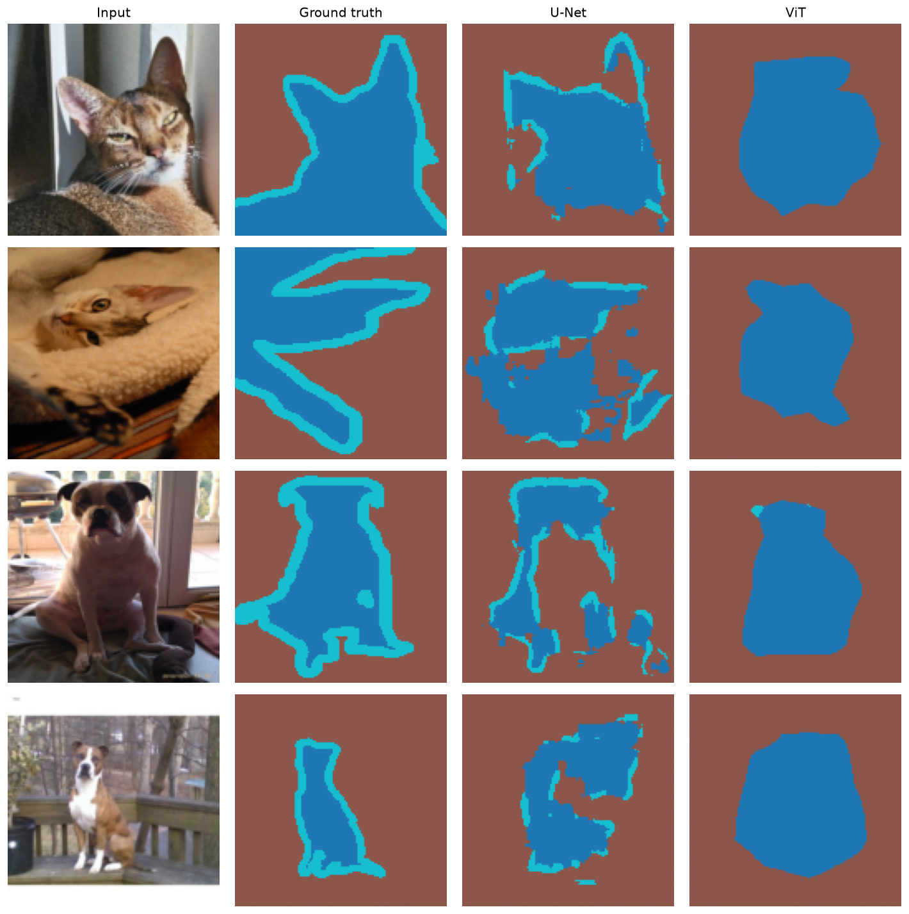
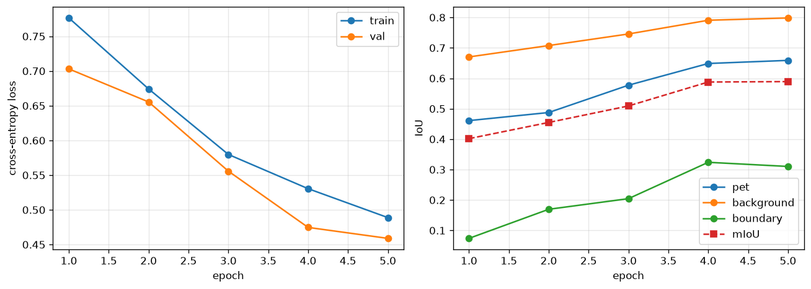

# Mini U-Net - Oxford-IIIT Pet Segmentation

Semantic segmentation on the Oxford-IIIT Pet dataset, with the U-Net architecture and the mIoU metric implemented from scratch. No pretrained segmentation models and no metric libraries were used

## Results 


Test split (3,669 images), 5 epochs, 128×128 input, batch size 8, Adam with lr=1e-3, seed 42.

| Class | IoU |
|---|---|
| 0 — pet | 0.6361 |
| 1 — background | 0.7888 |
| 2 — boundary | 0.3035 |
| **mIoU** | **0.5761** |

Per-epoch progression:

| Epoch | Train loss | Val loss | mIoU |
|---|---|---|---|
| 1 | 0.7721 | 0.7082 | 0.3915 |
| 2 | 0.6672 | 0.6190 | 0.4766 |
| 3 | 0.5660 | 0.5418 | 0.5172 |
| 4 | 0.5140 | 0.4821 | 0.5819 |
| 5 | 0.4857 | 0.4761 | 0.5761 |



## Observations

The boundary class is consistently the weakest, reaching only 0.30 IoU while the other
two classes exceed 0.63. It occupies a band of two to three pixels, so a prediction that
is offset by even a single pixel loses most of its overlap with the ground truth: the
intersection collapses while the union barely shrinks. The same offset on a large region
such as the background is negligible. IoU is therefore much harsher on thin structures
than on large ones, and a model can look far worse on them than it actually is.

The boundary class is also the least stable across training. It climbs from 0.05 to 0.31
over four epochs and then dips slightly in the fifth, which is enough to pull the overall
mIoU down from 0.5819 to 0.5761 even though both loss curves are still improving. Part of
the difficulty is in the labels themselves: the exact pixel where fur ends is a judgment
call for the annotator. A wider receptive field does not help here. What this class needs
is high-resolution spatial detail, which is exactly what the pooling layers discard, and
what the skip connections only partially restore.

## Implemented from scratch

- `src/model.py` - U-Net architecture (encoder, decoder, bottleneck, skips).
- `src/metrics.py` - per-class IoU and mIoU. Intersection and union counts are accumulated across the full validation set and divided only at the end, rather than averaging per-batch IoU values.

## Setup

```bash
pip install -r requirements.txt
python src/train.py
```

The dataset is downloaded automatically on first run (~800 MB).

## Implementation notes

- Masks are resized with `NEAREST` interpolation. Bilinear interpolation would produce intermediate values between class indices, inventing labels that do not exist.
- Labels are shifted from 1–3 to 0–2, since `CrossEntropyLoss` expects zero-based class indices.
- Training and evaluation are seeded for reproducibility.

## Repository layout

```
src/
├── model.py      # MiniUNet
├── metrics.py    # IoU and mIoU
├── data.py       # transforms and dataloaders
├── train.py      # training and evaluation loop
├── visualize.py      # prediction grid
└── plot_metrics.py   # training curves
```